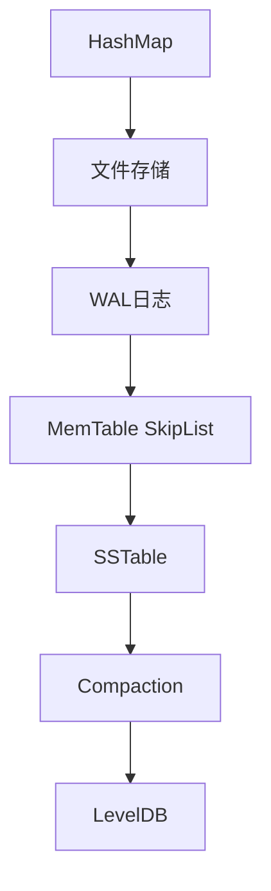
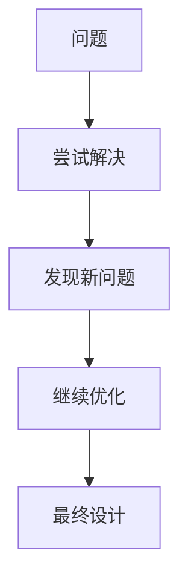
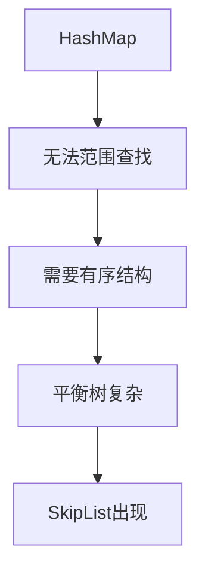
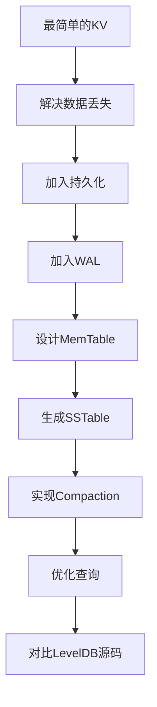
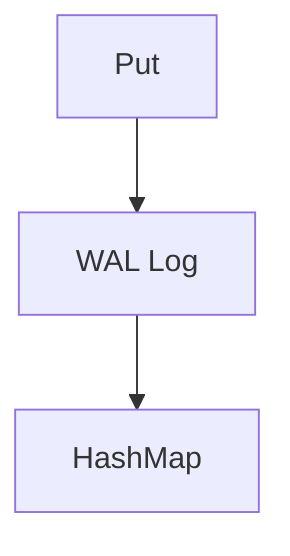
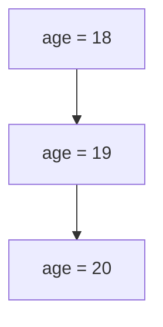

# LevelDB源码剖析：从零实现MiniLevelDB理解LSM-Tree存储引擎设计


<!--more-->

## 为什么不直接阅读LevelDB源码？

学习一个优秀的开源项目时，很多人的第一反应是直接阅读源码。然而，对于LevelDB这样的工业级存储引擎，这种方式往往会遇到很大的困难。并不是因为LevelDB的代码质量不好，相反，LevelDB的代码非常优秀，结构清晰，模块职责明确。但优秀的工程代码通常是在大量真实需求和历史演进中形成的，它隐藏了许多设计背景：

- 为什么需要这个模块？
- 为什么选择这种数据结构？
- 为什么这里要增加一层抽象？
- 如果没有这个设计，会遇到什么问题？

如果不了解这些问题，阅读源码很容易变成：

> 看到大量代码，却不知道这些代码正在解决什么问题。

**LevelDB到底解决了什么问题？**

在阅读LevelDB源码之前，首先需要了解它存在的背景。最简单的Key-Value存储其实非常简单，使用`unordered_map<string, string>`即可，数据存放在内存(HashMap)中。这样看起来已经可以工作。但是，当需求不断增加：

- 程序关闭后数据不能丢失怎么办？
- 数据越来越大，内存放不下怎么办？
- 写入频繁，随机磁盘写性能太差怎么办？
- 如何支持范围查询？
- 如何避免大量磁盘查找？
- 如何清理越来越多的数据文件？

一个简单的HashMap会逐渐无法满足需求。于是系统开始演进：



LevelDB并不是一开始就设计成今天这个样子，而是在不断解决问题的过程中演化出来的。

### 直接阅读源码的问题

#### 1. 缺少问题背景

当第一次看到：

```cpp
class MemTable {
  public:
    void Add(SequenceNumber seq, ValueType type, const Slice& key,
           const Slice& value);
}
```

难免会疑惑：为什么数据库需要一个`MemTable`？为什么不直接写磁盘？为什么里面保存`SequenceNumber`？为什么需要`ValueTyupe`？

这些问题如果直接看代码，很难回答。但如果我们自己实现过：`Put(key, value)`直接写磁盘。就会发现每次写磁盘太慢、多个修改同一个Key浪费空间、需要保证恢复能力。很自然会想到先写内存，再写入磁盘。这时`MemTable`的存在就变得非常自然。

#### 2. 看到了设计结果，却不知道设计过程

LevelDB有大量优秀设计，比如：SkipList、WAL、SSTable、Bloom Filter、Iterator、VersionSet、Compaction等等。直接看源码看到的是*最终答案*。但是学习真正重要的是：



比如，为什么不用HashMap，而使用SkipList？直接看代码我们会知道LevelDB使用了SkipList，但是自己实现过程中：



我们会真正理解：

> SkipList不是为了炫技，而是在工程复杂度和性能之间的选择。

#### 3. 容易陷入细节，失去整体结构

LevelDB源码中有大量细节，例如`Slice`字符串封装、`Arena`内存管理、`Reference`计数、`Mutex`同步等等，这些代码单独看都很重要。但是如果不知道整体架构，很容易陷入：看到一个类->研究几个小时->忘记它为什么存在。学习大型项目更合理的方式可能是先建立系统地图，再深入城市道路，而不是一开始研究每一块砖。

### 为什么选择从零实现MiniLevelDB？

实现一个MiniLevelDB的目的，并不是为了替代LevelDB。真正的目标是：

> 通过经历一次存储引擎的演进过程，理解LevelDB每一个设计背后的原因。

当然，如果你有其他更好的方式，欢迎留言评论😁。我们的实现路线：



每一步都会产生新的问题：

| 遇到的问题               | LevelDB中的解决方案 |
| :----------------------- | :------------------ |
| 数据重启丢失             | WAL                 |
| 内存无限增长             | SSTable             |
| 查询效率下降             | Bloom Filter        |
| 文件越来越多             | Compaction          |
| 数据版本混乱             | VersionSet          |
| 多种数据来源访问方式不同 | Iterator            |

当我们最后打开LevelDB源码，就不再是一堆陌生类名和术语，因为我们已经经历过它们为什么出现。

### 学习复杂系统的另一种方式

对于大型系统，阅读代码更适合作为验证设计，而不是寻找设计。通过实现MiniLevelDB，我们先建立问题意识、架构认知、核心机制理解，然后在阅读LevelDB，源码中的每一个设计都会变成：

> 原来它是在解决这个问题。

这也是本文选择**从零实现 MiniLevelDB**，而不是直接阅读 LevelDB 源码的原因。

## 从HashMap开始实现Key-Value存储引擎

在理解LevelDB的设计之前，我们先暂时忘掉所有复杂的概念。假设现在只有一个最简单的需求：

> 设计一个能够存储Key-Value数据的系统。

例如：

```cpp
Put("name", "Anthony");
Put("age", "22");
```

随后可以查询：

```cpp
Get("name"); // "Anthony"
Get("age"); // "22"
```

也可以删除数据：

```cpp
Delete("age");
```

如果只是实现这些最基础的功能，我们不需要设计任何复杂的数据结构。C++标准库已经提供了最合适的选择——`std::unordered_map`。

```cpp
class MiniDB {
public:
  void Put(const std::string& key, const std::string& value) {
    data_[key] = value;
  }

  bool Get(const std::string& key, std::string& value) const {
    auto it = data_.find(key);
    if (it == data_.end()) {
      return false;
    }
    value = it->second;
    return true;
  }

  void Delete(const std::string& key) {
    data_.erase(key);
  }

private:
  std::unordered_map<std::string, std::string> data_;
};
```

`MiniDB`只有一个成员`data_`，所有数据都保存在内存中。整个系统非常简单：

- `Put()`：向HashMap插入或更新数据
- `Get()`：根据Key查找数据
- `Delete()`：删除指定Key

几十行代码就完成了Key-Value存储。

### 为什么选择HashMap？

因为它满足了我们当前所有需求，并且HashMap的查找、插入、删除平均时间复杂度都是$O\left(1\right)$。对于一个简单的Key-Value系统来说，没有比HashMap更适合的数据结构了。

### 第一个工程问题

但是，如果它真的作为数据库投入使用，很快就会暴露出一个严重问题。

例如：

```cpp
Put("name", "Anthony");
Put("age", 22);
```

当程序退出后，再次启动程序`Get("name")`找不到值了。原因很简单：所有数据都保存在内存中，而内存是易失性的。程序一旦退出，整个HashMap就会被释放，所有数据随之丢失。这意味着：它只是一个内存缓存，而不是一个真正意义上的数据库。

至此，我们第一次遇到了真实数据库需要解决的问题：

> 如何让数据在程序退出后依然存在？

我们需要让数据脱离内存，保存到磁盘中。于是，我们的MiniLevelDB将迎来第一次架构演进，为MiniLevelDB增加持久化功能力，让它朝真正数据库迈进一步。

## 数据持久化：解决程序重启数据丢失

数据库最基本的能力之一，就是数据持久化。即使程序关闭、服务器重启，数据依然能够恢复。

### 最直接的方案：写入文件

如果让我们自己设计，第一个想到的方案非常简单：把HashMap保存到磁盘。

例如：

```text
name=Anthony
age=22
```

程序启动时：读取文件->解析内容->恢复HashMap。程序退出时：HashMap->写入文件。这样，我们数据就不会因为程序退出而消失。可以实现两个方法：`Load()`和`Save()`。

```cpp
class MiniDB {
public:

  void Load() {
    std::ifstream ifs("database.txt");
    if (!ifs.is_open()) return;
    std::string line, key, value;

    data_.clear();

    while (std::getline(ifs, line)) {
      auto pos = line.find('=');
      if (pos == std::string::npos) continue;
      key = line.substr(0, pos);
      value = line.substr(pos + 1);
      data_.emplace(std::move(key), std::move(value));
    }
  }

  void Save() {
    std::ofstream ofs("database.txt");
    for (auto& [key, value] : data_) {
      ofs << key << "=" << value << '\n';
    }
  }
}
```

程序启动`db.Load()`，程序退出`db.Save()`。整个数据库已经有了真正的数据持久化能力。

### 新问题

这种方案真的可以吗？假设数据库里有100000条数据，现在执行`db.Put("age", 20)`。只有一条数据发生变化，我们目前的方案也会重新遍历整个HashMap，重新生成整个`database.txt`覆盖原来的文件。也就是说，修改一个Key将会导致写入100000条数据。如果数据库存储的数据越来越多，1000万条->1亿条。那么每次写入：

```cpp
int main() {
  MiniDB db;
  db.Load();
  db.Put("city", "New York");
  db.Save();
  return 0;
}
```

都需要读取内存中的HashMap，重新生成整个数据库文件,然后覆盖。这样的效率显然无法接受。磁盘访问速度远远低于内存，尤其是随机写(Random Write)。CPU很快，HashMap很快，真正慢的是磁盘I/O。现在数据库的性能问题，本质上是如何减少磁盘读写。

### 更好的办法

仔细观察会发现，每一次`Put`，比如：

```cpp
db.Put("age", 19);
```

真正发生变化的只有`age`->19。为什么我们要重新写整个数据库？可以只追加这次操作。下次`db.Delete("age")`，继续追加。所有操作都只是追加，而不是将整个文件覆盖。整个文件变成：

```text
PUT age 18
DELETE age
```

这种设计不仅写入速度快，还能够记录所有修改历史。事实上，这正是现代数据库广泛采用的一种思想——**Write-Ahead Log(WAL，预写日志)**。

## WAL：数据库如何保证写入可靠性

Write-Ahead Log(WAL，预写日志)记录的不是数据库当前长什么样，而是数据库经历了哪些操作。例如：

```text {title="wal.log"}
PUT name Anthony
PUT age 18
PUT age 19
DELETE name
```

每一次修改数据库，第一件事不是修改数据库文件，而是写日志。整个写入流程变成：



注意这个顺序：先写日志，再更新内存。这也是Write-**Ahead** Log名称的由来。

为什么要先写日志，在更新内存？而不是更新内存后再写日志。

举一个断电的例子，`Put()`->更新HashMap->突然断电->日志没写，修改丢失。而`Put()`->日志写成功->断电，启动时可以根据日志恢复。

由于WAL是Append(顺序写)，而不是Rewrite(随机写)，写入速度会更快。这是数据库经典的一种优化思想：

> 把随机转换成顺序写

### 新的问题出现

数据库运行了大半年，`wal.log`文件已经300G了。启动时恢复HashMap耗费了很多时间，这显然不能接受。

++WAL可以一直增长吗？++

显然是不行。那什么时候可以删除呢？只有当这些数据已经安全保存到另一个地方的时候。

## MemTable的演进：为什么HashMap最终被SkipList替代？

经过前面的改进，我们的MiniLevelDB已经具备数据库最基本的能力。每次吸入都会先记录到WAL，再更新内存中的数据。其中，内存中的HashMap就承担了**MemTable**的角色。所谓的MemTable，并不是一种特殊的数据结构，而是**当前可写的内存表**。在我们的实现中，它由`std::unordered_map`实现。而在LevelDB中，它采用了SkipList。那么，一个新问题来了：

> HashMap查询速度已经很快了，为什么还要把它换成SkipList？

HashMap的最大有点就是查询快，底层根据Key计算哈希值，就能够快速定位数据。如果数据库只要支持`Get(key)`，那么HashMap是很好的选择。遗憾的是，数据库除了查询单个Key，还经常需要按**Key的大小顺序**访问数据。这类操作通常称为范围查询或有序遍历。

HashMap的内部组织方式决定了**它只关心哈希值，而不关心Key大小顺序**。

我们需要一种“有序”的数据结构，既然HashMap不适合范围查询，那么MemTable至少需要满足两个条件：

- 写入速度够快
- 数据能够保持有序

有哪些选择？例如：AVL树、红黑树(`std::map`)、B+树、SkipList都能按照Key排序。为什么LevelDB选择了SkipList？这是因为其他几种数据结构，维护成本较高，也不利于后续的并发优化。相比之下，SkipList的实现要简单得多。对于MemTable而言，它最重要的特点是：

> 写入频繁、读取频繁，而且数据始终保持有序

SkipList正好满足这些需求：

- 查询效率高
- 插入效率高
- 天然保持Key有序
- 实现简单，代码量远少于平衡树


因此，LevelDB从一开始就选择SkipList作为MemTable的底层实现。我们将MiniLevelDB也进行升级，将`std::unordered_map<string, string>`升级为MemTable(SkipList)。虽然单次查询从平均 $O\left(1\right)$ 变成了 $O\left(logN\right)$,但数据始终保持有序。

## SSTable：如何将内存数据保存到磁盘

现在我们将MemTable从HashMap升级为了SkipList，一个数据库已经初具雏形。但一个问题很快就出现了。MemTable可以一直增长吗？显然不能。MemTable本质上是一块内存，如果我们程序一直`Put`，MemTable会不断增长，最终内存耗尽，程序崩溃。所以，MemTable不能无限增长。必须在合适的时候，把内存中的数据转移到磁盘中。

一个很自然的想法是：MemTable->保存成一个文件->清理MemTable->继续接收新的写入。这样内存始终保持在一个可控范围内。注意：**一旦MemTable保存成了文件，我们就不会再对该文件进行操作了**。如果有新的写入，我们保存为新的文件。为什么不能追加到文件中？这种方案会带来很多问题。

假如文件中已经有：

```text
user001
user009
user015
......
user980
```

现在插入`user003`，为了保持整个文件有序，我们需要修改文件中间数据。磁盘文件不像内存，可以方便地插入元素。为了插入一条记录，可能需要移动大量数据，导致效率很低。既然修改文件代价这么高，那么**为什么不修改？**

数据库可以采用一种新方案，当MemTable达到一定大小时，一次性写入磁盘，生成新文件，以后不再修改该文件。例如：第一次Flush `001.sst`，第二次Flush `002.sst`，第三次Flush `003.sst`……。每一个文件生成以后都不会再发生变化。由于MemTable(SkipList)中的数据天然有序，Flush时只需要遍历MemTable，顺序写入磁盘即可，整个过程不需要排序。这也是LevelDB选择SkipList另一个重要原因。

查询怎么办？比如查询`db.Get("user100")`，流程变成：


为什么要倒着查？因为最新的数据永远在最新生成的文件中，因此必须优先访问最新的数据。

### 新的问题

随着数据库的不断运行,sst文件越来越多，每次查询需要检查的文件越来越多。写入快，而读取慢。有什么办法把这些sst文件合并起来？这就是LevelDB最核心的机制之一：Compaction(压缩合并)。

## Compaction：如何控制磁盘文件增长

Compaction的工作可以概括为3件事。

### 合并多个SSTable

比如将001.sst、002.sst、003.sst合并为010.sst。SSTable文件经过多次Compaction大大减少了数量，查询访问的文件数量也大幅减少。

### 删除旧版本的数据

例如：



最终只保留`age = 20`。

### 清理已删除的数据

数据库删除一个Key，实际上并没有立即从SSTable中删除。通常只是给个删除标记，Compaction时如果确定就数据不再需要，再彻底删除。

通过Compaction，数据库中的冗余数据越来越少，查找效率也越来越高。

### 新的问题

Compaction虽然减少了SSTable的数量，但是查询一个不存在的Key。仍然可能需要访问很多文件，最后才发现不存在。大量的磁盘访问都浪费了，有没有一种方法能够在真正读取SSTable之前，就知道这个Key一定不存在。我们可以使用[Bloom Filter](https://en.wikipedia.org/w/index.php?title=Bloom_filter&oldformat=true)。

## Bloom Filter：减少无效查询

如果能做到这个Key一定不存在，那么可以直接结束。后面的的SSTable就根本不用访问，大量磁盘I/O都可以避免。Bloom Filter可以巧妙地实现实现这点。它不保存完整的Key，而是保存Key的“痕迹”。每一个Key经过几个哈希函数，对应的位置标记为1。整个Bloom Filter看起来就像一张位图：`0 0 1 0 1 0 0 1 1 0 0 1 ......`。随着越来越多的Key加入，越来越多的位置会变成1。但是真正保存的数据量却非常小，通常每个Key只需要几比特的空间。


在LevelDB中，Bloom Filter并不是整个数据库共享一个。而是每一个SSTable都有自己的Bloom Filter。如果所有SSTable的Bloom Filter都判断不存在，数据库可以直接返回“未找到”。整个过程中，我们不必读取SSTable的真实数据。因此，大量不存在的数据查询都会被Bloom Filter提前拦截，无需真正访问磁盘。

## 对比LevelDB源码：工业实现解决了哪些问题

## 番外

### 如何调试LevelDB？

执行以下命令将LevelDB项目克隆到本地：

```bash
git clone --recurse-submodules https://github.com/google/leveldb.git
```

LevelDB本身是一个Key-Value存储引擎，并没有提供`main`入口函数。为了方便调试，参考[reading-source-code-of-leveldb-1.23](https://github.com/SmartKeyerror/reading-source-code-of-leveldb-1.23)中的做法。在项目根目录下，新建`debug/leveldb_debug.cc`文件：

```cpp {title="debug/leveldb_debug.cc"}
#include <iostream>
#include <string>

#include "leveldb/db.h"

using namespace std;

int main() {
  leveldb::DB* db;
  leveldb::Options options;

  options.create_if_missing = true;

  leveldb::Status status = leveldb::DB::Open(options, "./leveldb_test", &db);

  if (!status.ok()) {
    cerr << status.ToString() << endl;
  }

  leveldb::WriteOptions writeOptions;

  db->Put(writeOptions, "hello", "world");
  string value;
  db->Get(leveldb::ReadOptions(), "hello", &value);
  cout << "Keyword value : " << value << endl;
  db->Put(writeOptions, "hello1", "nice");

  if (!status.ok()) {
    cerr << status.ToString() << endl;
  }

  delete db;
  return 0;
}

```

并在`CMakeLists.txt`中增加下图所示内容：


## 推荐

[leveldb doc](https://github.com/google/leveldb/tree/main/doc)

[Skip List Data Structure - Explained!](https://blog.reachsumit.com/posts/2020/07/skip-list/)

[如何基于LSM-tree架构实现一写多读](https://help.aliyun.com/zh/polardb/polardb-for-mysql/implement-an-one-primary-and-multi-read-architecture-based-on-lsm-trees)

## 参考

[Just For Fun](https://selfboot.cn/archives/)

[Ying](https://izualzhy.cn/archive.html?tag=leveldb)

[leveldb-handbook](https://leveldb-handbook.readthedocs.io/zh/latest/index.html)

[reading-source-code-of-leveldb-1.23](https://github.com/SmartKeyerror/reading-source-code-of-leveldb-1.23)

[leveldb 源码分析(二) – Architecture](https://youjiali1995.github.io/storage/leveldb-architecture/)

[Understanding and Implementing Skiplists](https://rowjee.com/blog/skiplists)


---

> 作者: [AndyFree96](https://andyfree96.github.io/)  
> URL: http://localhost:1313/leveldb%E6%BA%90%E7%A0%81%E5%89%96%E6%9E%90/  

