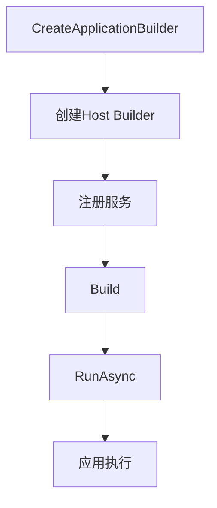
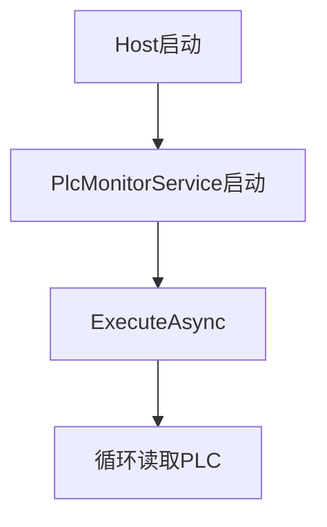
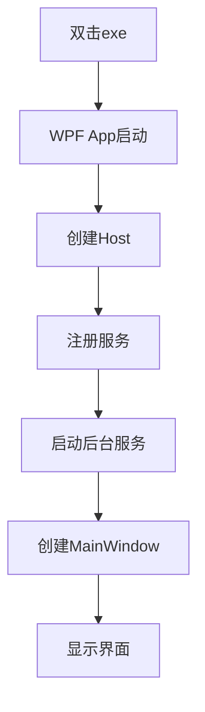
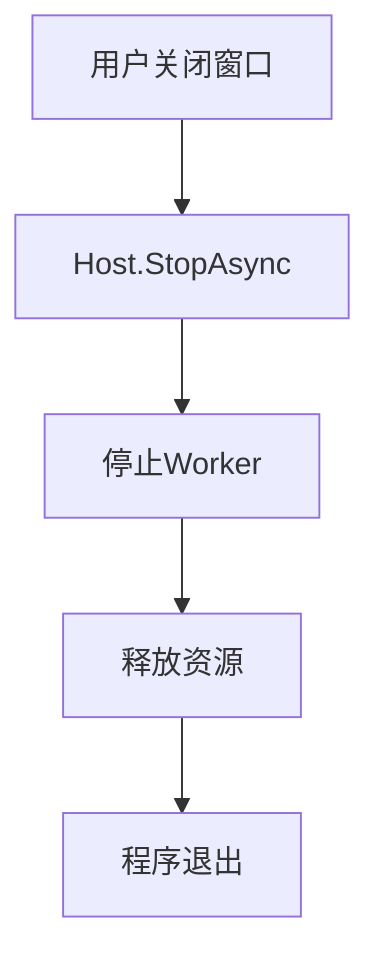

# Microsoft.Extensions.Hosting使用指南：构建现代 .NET 应用的通用宿主架构


在传统.NET应用中，程序入口通常承担大量职责：

```c#
static void Main(string[] args) {
  var plc = new PlcService();
  plc.Connect();

  var camera = new CameraService();
  camera.Open();

  while (true) {
    plc.Read();
  }
}
```

随着应用规模增长，`Main`方法会逐渐演变成创建各种对象、管理对象生命周期、初始化资源、启动后台线程、处理配置、初始化日志等等，最终形成一个巨大的入口文件。对于工业软件、桌面软件、后台服务等长期运行程序，这种方式存在明显问题：

- 模块之间高度耦合
- 生命周期管理困难
- 难以测试
- 服务无法复用
- 资源释放容易遗漏

因此，现代.NET引入了通用宿主(Generic Host)。它的核心思想：

> 将应用程序中的各种模块注册到Host中，由Host统一负责创建、启动、运行和关闭。

<!--more-->

整体架构：


## 什么是Host？

Host可以理解为++管理应用生命周期的运行环境++。类似Web Host管理Web Application，Docker Host管理Container。Host本身不负责业务逻辑。

Host负责：

- 创建服务
- 管理依赖
- 加载配置
- 初始化日志
- 启动后台服务
- 优雅关闭

业务代码负责：

- PLC如何通迅
- 相机如何采集
- 算法如何计算


## 创建Host

安装：

```bash
dotnet add package Microsoft.Extensions.Hosting
```

创建：

```c#
using Microsoft.Extensions.Hosting;

var builder = Host.CreateApplicationBuilder(args);

var host = builder.Build();

await host.RunAsync();
```

这是一个最基础的Host应用，执行流程：



## 使用依赖注入

Host默认集成依赖注入(Dependency Injection, DI)。例如定义一个服务：

```c#
public interface ICameraService
{
    void Capture();
}

public class CameraService : ICameraService
{
    public void Capture()
    {
        Console.WriteLine($"{nameof(CameraService)} capture image");
    }
}
```

注册并使用：

```c#
var builder = Host.CreateApplicationBuilder(args);

builder.Services.AddSingleton<ICameraService, CameraService>();

var host = builder.Build();

var cameraService = host.Services.GetRequiredService<ICameraService>();
cameraService.Capture();

await host.RunAsync();
```

## 服务生命周期

.NET DI提供三种生命周期：Singleton、Transient和Scoped。

### Singleton

整个应用程序只有一个实例，一般用于资源对象。

```c#
builder.Services.AddSingleton<ICameraService, CameraService>();
```

适合PLC连接、相机管理、轴卡控制、数据库连接等。

### Transient

每次获取创建新实例，一般用于计算对象。

```c#
builder.Services.AddTransient<ImageProcessor>();
```

适合无状态、轻量对象，比如算法处理器、数据转换器、参数验证器等。

### Scoped

一个Scoped一个实例，主要用于ASP.NET Core请求，工业软件中使用较少。

## 使用BackgroundService创建后台服务

工业软件大量存在后台循环任务。例如：PLC读取IO，更新状态。可以使用`BackgroundService`。

创建：

```c#
public class PlcMonitorService : BackgroundService
{
    protected override async Task ExecuteAsync(CancellationToken stoppingToken)
    {
        while (!stoppingToken.IsCancellationRequested)
        {
            ReadPLC();
            
            await Task.Delay(1000, stoppingToken);
        }
    }

    private void ReadPLC()
    {
        Console.WriteLine($"{nameof(PlcMonitorService)} reading PLC {DateTime.Now}");
    }
}
```

注册：

```c#
builder.Services.AddHostedService<PlcMonitorService>();
```

启动后：



## 配置管理

不要在源代码中将参数写死：

```c#
string ip = "192.168.1.10";
```

推荐创建`appsettins.json`文件：

```json
{
  "PLC":
  {
    "IP":"192.168.1.10",
    "Port":502
  }
}
```

定义：

```c#
public class PlcOptions
{
    public string IP { get; set; }
    public int Port { get; set; }
}
```

注册：

```c#
builder.Services.Configure<PlcOptions>(builder.Configuration.GetSection("PLC"));
```

使用：

```c#
public class PlcMonitorService(IOptions<PlcOptions> options) : BackgroundService
{
    private readonly PlcOptions options = options.Value;

    protected override async Task ExecuteAsync(CancellationToken stoppingToken)
    {
        while (!stoppingToken.IsCancellationRequested)
        {
            ReadPLC();
            
            await Task.Delay(1000, stoppingToken);
        }
    }

    private void ReadPLC()
    {
        Console.WriteLine($"{nameof(PlcMonitorService)} reading PLC {DateTime.Now} IP:{options.IP} PORT: {options.Port}");
    }
}
```

## 日志

Host默认提供日志系统。

使用：

```c#
public class CameraService(ILogger<CameraService> logger) : ICameraService
{
    private readonly ILogger<CameraService> logger = logger;

    public void Capture()
    {
        logger.LogInformation("Starting camera capture");
    }
}
```

`Microsoft.Extensions.Hosting`默认输出是控制台和Debug窗口，如果需要将其保存到文件中，常用方案是`Serilog`、`Nlog`或`log4net`。目前.NET工程中Serilog + Microsoft.Extensions.Hosting是最常见的组合。

### 安装Serilog

安装NuGet包：

```bash
dotnet add package Serilog.Extensions.Hosting

dotnet add package Serilog.Sinks.File

dotnet add package Serilog.Settings.Configuration
```

作用：

| 包                              | 作用      |
| :------------------------------ | :------- |
| Serilog.Extensions.Hosting     | 集成 Host |
| Serilog.Sinks.File             | 输出文件    |
| Serilog.Settings.Configuration | 读取配置    |

### 配置appsettings.json

创建`appsettings.json`(如果项目中没有该文件的话)，加入：

```json
{
  "Serilog": {
    "MinimumLevel": {
      "Default": "Information",
      "Override": {
        "Microsoft": "Warning"
      }
    },

    "WriteTo": [
      {
        "Name": "File",
        "Args": {
          "path": "Logs/log-.txt",
          "rollingInterval": "Day",
          "retainedFileCountLimit": 30,
          "outputTemplate":
          "{Timestamp:yyyy-MM-dd HH:mm:ss.fff} [{Level}] {Message}{NewLine}{Exception}"
        }
      }
    ]
  }
}
```

### Host中接入Serilog

```c#
using Serilog;


var builder =
    Host.CreateApplicationBuilder(args);


// 使用Serilog替换默认Logger
builder.Services
    .AddSerilog(
        new LoggerConfiguration()
        .ReadFrom.Configuration(
            builder.Configuration)
        .CreateLogger()
    );


builder.Services
    .AddSingleton<PlcMonitorService>();


var host =
    builder.Build();


await host.RunAsync();
```

每天会生成新的日志文件：


如果想Serilog同时在Console和Debug Window输出，需要安装另外两个NuGet包：

```bash
dotnet add package Serilog.Sinks.Console
dotnet add package Serilog.Sinks.Debug
```

`appsettings.json`修改为：

```json
{
  "Serilog": {
    "Using": [
      "Serilog.Sinks.Console",
      "Serilog.Sinks.Debug",
      "Serilog.Sinks.File"
    ],

    "MinimumLevel": {
      "Default": "Information",
      "Override": {
        "Microsoft": "Warning",
        "System": "Warning"
      }
    },

    "WriteTo": [
      {
        "Name": "Console"
      },

      {
        "Name": "Debug"
      },

      {
        "Name": "File",
        "Args": {
          "path": "Logs/app-.log",
          "rollingInterval": "Day",
          "retainedFileCountLimit": 30,
          "outputTemplate":
          "{Timestamp:yyyy-MM-dd HH:mm:ss.fff} [{Level:u3}] {SourceContext} {Message:lj}{NewLine}{Exception}"
        }
      }
    ],

    "Enrich": [
      "FromLogContext",
      "WithMachineName",
      "WithThreadId"
    ]
  }
}
```


## Host生命周期管理

Host可以统一管理应用程序从启动、运行到关闭的完整生命周期。

一个Host的生命周期如下：


核心组件：

| 组件                       | 作用       |
| :------------------------ | :-------- |
| IHostedService           | 定义生命周期   |
| BackgroundService        | 后台循环任务   |
| StartAsync               | 启动初始化    |
| ExecuteAsync             | 持续运行     |
| StopAsync                | 停止释放     |
| CancellationToken        | 优雅退出     |
| IHostApplicationLifetime | 主动控制生命周期 |

`IHostApplicationLifetime`是.NET Generic Host中用于控制应用程序生命周期的核心接口，其定义如下：

```c#
public interface IHostApplicationLifetime
{
    CancellationToken ApplicationStarted { get; }

    CancellationToken ApplicationStopping { get; }

    CancellationToken ApplicationStopped { get; }

    void StopApplication();
}
```

| 成员                  | 作用       |
| :------------------- | :-------- |
| ApplicationStarted  | Host启动完成 |
| ApplicationStopping | 准备关闭     |
| ApplicationStopped  | 已经关闭     |
| StopApplication()   | 主动停止Host |

例如，我们在`ApplicationStarted`后执行一些初始化操作：

```c#
public class DeviceInitializeService(IHostApplicationLifetime applicationLifetime, ILogger<DeviceInitializeService> logger) 
    : IHostedService
{
    private readonly IHostApplicationLifetime appLifetime = applicationLifetime;
    private readonly ILogger<DeviceInitializeService> logger = logger;
    
    public Task StartAsync(CancellationToken cancellationToken)
    {
        appLifetime.ApplicationStarted.Register(() =>
        {
            _ = InitializeDevice();
        });
        
        return Task.CompletedTask;
    }

    public Task StopAsync(CancellationToken cancellationToken)
    {
        return Task.CompletedTask;
    }

    private async Task InitializeDevice()
    {
        logger.LogInformation("开始初始化");
        
        await Task.Delay(2000, appLifetime.ApplicationStopping);
        
        logger.LogInformation("结束初始化");
    }
}
```

使用：

```c#
var builder = Host.CreateApplicationBuilder(args);

builder.Services.AddHostedService<DeviceInitializeService>();

var host = builder.Build();

await host.RunAsync();
```


## WPF中使用Generic Host

在`App.xaml`中移除`StartupUri`，改为：

```xml
<Application x:Class="WPFHostDemo.App"
             xmlns="http://schemas.microsoft.com/winfx/2006/xaml/presentation"
             xmlns:x="http://schemas.microsoft.com/winfx/2006/xaml"
             xmlns:local="clr-namespace:WPFHostDemo">
    <Application.Resources>
         
    </Application.Resources>
</Application>

```

窗口不在由WPF创建，而是由Host掌控。在`App.xaml.cs`中创建Host：

```c#
public partial class App : Application
{
    public IHost Host { get; }

    public App()
    {
        var builder = Microsoft.Extensions.Hosting.Host.CreateApplicationBuilder();
        ConfigureServices(builder.Services);
        Host = builder.Build();
    }

    private static void ConfigureServices(IServiceCollection services)
    {
        services.AddSingleton<WPFHostDemo.MainWindow>();
    }
}
```

现在，Host已经成为WPF应用的根。

重写`OnStartup`以启动Host：

```c#
    protected override async void OnStartup(StartupEventArgs e)
    {
        await Host.StartAsync();
        
        var mainWindow = Host.Services.GetRequiredService<MainWindow>();
        
        mainWindow.Show();
        
        base.OnStartup(e);
    }
```

启动流程：



WPF退出时，关闭Host：

```c#
    protected override async void OnExit(ExitEventArgs e)
    {
        await Host.StopAsync();
        Host.Dispose();
        base.OnExit(e);
    }
```

关闭流程：



这里的停止Worker指的是后台工作服务(Background Worker)，也就是实现了`IHostService`的后台服务。

## 总结

`Microsoft.Extensions.Hosting`提供了一套现代 .NET 应用架构模式：DI + Configuration + Logging + IHostedService。它解决的问题：

| 问题     | 解决方案              |
| :------ | :----------------- |
| 对象创建混乱 | DI                |
| 生命周期管理 | Host              |
| 后台任务   | IHostedService |
| 配置管理   | Options           |
| 日志管理   | ILogger           |
| 模块耦合   | 接口抽象              |

对于传统桌面软件、工业设备软件、自动化控制系统，这种结构可以很好地支撑从单机设备向复杂自动化平台演进。

---

> 作者: [AndyFree96](https://andyfree96.github.io/)  
> URL: http://localhost:1313/microsoft.extensions.hosting%E4%BD%BF%E7%94%A8%E6%8C%87%E5%8D%97/  

