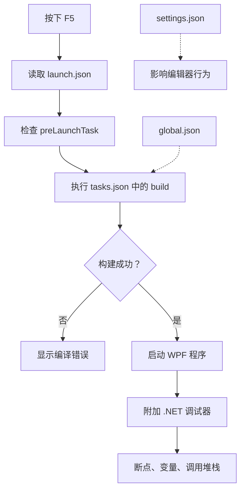

# VS Code调试WPF实战：从dotnet build到F5断点调试


最近，在开发设备软件时，我遇到了一个比较实际的问题：设备工控机的开发环境比较受限，安装的 Visual Studio 还是 2019 版本，无法直接满足当前项目对 .NET 9（net9.0-windows）的开发需求(现场不具备网络环境)。与此同时，在这台工控机上使用 Rider 进行调试时，整个系统也会变得比较卡顿。为了继续推进开发，我尝试使用 VS Code 修改项目，并通过 dotnet run 启动 WPF 应用。这种方式可以正常运行程序，却带来了一个新的问题：**如何在 VS Code 中像使用传统 IDE 一样设置断点、单步执行、查看变量和调用堆栈？**

经过一番摸索，我逐渐梳理出了使用 VS Code 开发和调试 WPF 应用的完整方案。本文记录这次实践，并进一步解释背后的工作机制。

<!--more-->

## 1. 为什么选择VS Code开发WPF？

传统的 WPF 开发通常使用 Visual Studio 或 Rider。这些 IDE 提供了比较完整的项目管理、XAML 编辑、代码补全、调试和可视化设计能力。

但在实际项目中，我们可能会遇到一些特殊情况：

- 开发机或工控机硬件资源有限，大型 IDE 运行时比较卡顿。
- 项目使用较新的 .NET SDK，而现有 IDE 版本较旧。
- 希望直接使用命令行构建项目，减少对特定 IDE 的依赖。
- 希望在远程设备、轻量级开发环境中修改和调试程序。
- 希望将构建、测试和发布流程逐步自动化。

VS Code 的优势在于轻量、可扩展，并且能够直接调用 .NET CLI 完成构建任务。

需要明确的是，**VS Code 并不是 WPF 专用 IDE 的完整替代品**。它可以通过 C# 扩展和调试器支持 WPF 程序的代码级调试，但不具备与 Visual Studio 相同的原生 WPF XAML 可视化设计体验。

对于以 C# 业务逻辑、设备通信、状态机、服务层和视觉算法开发为主的项目，VS Code 是一个值得尝试的选择。

## 2. 准备开发环境

### 2.1 安装必要的 VS Code 扩展

首先安装以下两款扩展：

- **C# Dev Kit**：提供 C# 项目和解决方案管理、代码导航等开发能力。
- **C#**：提供 C# 语言支持以及基于 .NET 调试器的调试能力。


C# Dev Kit 依赖 C# 扩展，两者配合使用可以获得比较完整的 C# 开发体验。

扩展可以在 VS Code 左侧的扩展面板中搜索安装，也可以在命令行中安装：

```powershell
code --install-extension ms-dotnettools.csharp
code --install-extension ms-dotnettools.csdevkit
```

注意：安装扩展不等于安装 .NET SDK。即使编辑器可以识别 C# 代码，本机仍然需要安装能够构建目标项目的 SDK。

### 2.2 检查 .NET SDK 环境

在终端执行：

```powershell
dotnet --info
dotnet --list-sdks
dotnet --list-runtimes
```


这三个命令分别用于查看当前 .NET 环境、已安装的 SDK 和已安装的运行时。

其中：

- SDK 负责项目还原、编译、发布等工作。
- Runtime 负责运行已经编译的应用程序。
- 对于目标框架为 `net9.0-windows` 的 WPF 应用，开发环境需要能够构建对应目标框架的项目，运行环境也需要满足其运行时要求。

例如，项目使用：

```xml
<PropertyGroup>
    <TargetFramework>net9.0-windows</TargetFramework>
    <UseWPF>true</UseWPF>
</PropertyGroup>
```

那么就需要确保当前选择的 SDK 支持 .NET 9。

另外，WPF 依赖 Windows 桌面框架，不能因为安装了 .NET SDK 就认为它可以在任意操作系统上运行。

## 3. 先让项目脱离 IDE 完成构建

在配置调试器之前，我建议先不要急着编写 `launch.json`，而是先确保项目可以独立构建。

假设项目结构如下：

```text
Sirius/
├── Sirius.sln
├── Sirius.UI/
│   ├── Sirius.UI.csproj
│   ├── App.xaml
│   ├── MainWindow.xaml
│   └── ...
└── .vscode/
```

在解决方案根目录打开终端，执行：

```powershell
dotnet restore Sirius.UI/Sirius.UI.csproj

dotnet build Sirius.UI/Sirius.UI.csproj --configuration Debug
```

如果项目可以正常编译，我们就可以继续配置 VS Code。

如果这里已经失败，那么应该先解决项目构建问题，而不是直接怀疑调试器。

常见原因包括：

- 当前使用的 SDK 版本不正确。
- NuGet 包还原失败。
- 项目引用的其他类库无法构建。
- 某些依赖包不兼容当前目标框架。
- XAML 编译或 C# 编译报错。
- 项目中的生成文件或中间构建状态异常。

这一步的核心思想是：**先把构建与调试分开验证，再通过 VS Code 将两者连接起来。**

### 3.1 理解 `dotnet restore`、`dotnet build` 和 `--no-restore`

.NET CLI 的几个常用命令如下：

| 命令                        | 作用                                     |
| --------------------------- | ---------------------------------------- |
| `dotnet restore`            | 还原项目依赖，生成 NuGet 资产文件        |
| `dotnet build`              | 构建项目，默认会先执行还原               |
| `dotnet build --no-restore` | 跳过还原，直接进入构建流程               |
| `dotnet run`                | 构建并运行项目，除非通过参数改变默认行为 |
| `dotnet clean`              | 清理项目的构建输出                       |

这里有一个容易混淆的地方。

`--no-restore` 并不是跳过编译，而是跳过 NuGet 还原。编译器仍然会根据项目和文件的变化执行必要的编译工作，正常的增量构建也仍然有效。

但如果修改了依赖、目标框架或相关项目配置，就可能需要重新执行 `dotnet restore`。

此外，`dotnet build --no-restore` 依赖已有且有效的还原结果。如果提示找不到 `obj` 目录下的 `*.nuget.dgspec.json` 或其他 NuGet 资产文件，应该优先检查是否执行过还原，以及当前项目是否使用了正确的 SDK 和构建配置。

## 4. 配置 VS Code：三个核心文件

VS Code 的工作区配置通常放在项目根目录的 `.vscode` 文件夹中。

对于 C# 项目，最值得理解的三个文件是：

- `settings.json`：控制编辑器和工作区行为。
- `tasks.json`：定义可重复执行的任务。
- `launch.json`：定义程序如何启动或附加调试。

另外，`.editorconfig` 用于统一代码风格，`extensions.json` 用于向团队成员推荐扩展，`global.json` 则用于控制 .NET SDK 的选择。

这些文件各自负责不同的事情，不应该混为一谈。

### 4.1 `settings.json`：减少编辑器的额外开销

对于包含大量构建文件、图像、日志和采集数据的工业软件项目，可以适当调整 VS Code 的工作区设置。

创建 `.vscode/settings.json`：

```json
{
  "editor.minimap.enabled": false,
  "editor.codeLens": false,
  "editor.inlayHints.enabled": "off",
  "editor.suggest.preview": false,
  "workbench.startupEditor": "none",
  "workbench.editor.enablePreview": true,
  "explorer.compactFolders": true,

  "files.watcherExclude": {
    "**/bin/**": true,
    "**/obj/**": true,
    "**/Logs/**": true,
    "**/Capture/**": true
  },

  "search.exclude": {
    "**/bin/**": true,
    "**/obj/**": true,
    "**/Logs/**": true,
    "**/Capture/**": true
  },

  "git.autofetch": false,
  "extensions.autoCheckUpdates": false
}
```

这些设置分别用于关闭代码缩略图、减少部分编辑器装饰、排除不需要搜索的文件，以及减少 Git 自动获取和扩展自动更新带来的后台活动。

需要注意几个细节。

**第一，`settings.json` 不是 C# 调试配置。** 它主要影响编辑器和工作区行为，并不会直接决定 WPF 程序能否编译或启动。

**第二，文件监视排除规则需要谨慎设置。** `bin` 和 `obj` 通常适合排除；但 `Images` 目录可能存放程序真正需要的图像资源。如果需要搜索这些资源、监控其变化或依赖文件变化触发工具行为，就不应盲目排除。

**第三，这些优化不一定能显著改善所有项目的性能。** C# 语言服务、扩展、项目规模、后台构建、图像处理和程序自身的资源消耗，都可能影响整体体验。我在实际项目中尝试过这套设置，但没有最终依赖它来解决性能问题。

### 4.2 `tasks.json`：将构建过程变成可重复执行的任务

创建 `.vscode/tasks.json`：

```json
{
  "version": "2.0.0",
  "tasks": [
    {
      "label": "build",
      "type": "process",
      "command": "dotnet",
      "args": [
        "build",
        "${workspaceFolder}/Sirius.UI/Sirius.UI.csproj",
        "--configuration",
        "Debug",
        "--verbosity",
        "minimal"
      ],
      "options": {
        "cwd": "${workspaceFolder}"
      },
      "problemMatcher": "$msCompile",
      "group": {
        "kind": "build",
        "isDefault": true
      }
    }
  ]
}
```

这里最关键的是几个配置项。

**`label`：任务名称**

```json
"label": "build"
```

这个名称不仅用于在 VS Code 的任务列表中识别任务，还可以被 `launch.json` 中的 `preLaunchTask` 引用。

**`type`：任务执行方式**

```json
"type": "process"
```

`process` 表示直接启动指定的可执行程序，并将 `args` 中的每个元素作为独立参数传递。

相比把整条命令写成 shell 字符串，这种方式更适合构建命令，也能减少路径中存在空格时的引号问题。

**`command` 和 `args`：构建命令**

```json
"command": "dotnet",
"args": [
  "build",
  "${workspaceFolder}/Sirius.UI/Sirius.UI.csproj",
  "--configuration",
  "Debug",
  "--verbosity",
  "minimal"
]
```

这里相当于执行：

```powershell
dotnet build Sirius.UI/Sirius.UI.csproj `
    --configuration Debug `
    --verbosity minimal
```

`${workspaceFolder}` 表示当前打开的工作区文件夹。

**`options.cwd`：工作目录**

```json
"options": {
  "cwd": "${workspaceFolder}"
}
```

它决定构建命令从哪个目录开始执行。对于包含多个项目的解决方案，明确指定工作目录有助于避免相对路径混乱。

**`problemMatcher`：识别编译错误**

```json
"problemMatcher": "$msCompile"
```

它帮助 VS Code 从构建输出中识别编译错误和警告，并将其展示在 Problems 面板中。

**`group`：设置默认构建任务**

```json
"group": {
  "kind": "build",
  "isDefault": true
}
```

配置完成后，可以使用 VS Code 的“运行生成任务”命令执行构建；默认构建任务也可以通过相应的构建快捷键触发。

与 `settings.json` 不同，`tasks.json` 已经进入实际开发流程：它可以执行构建、测试、清理、发布等命令，也可以被调试配置自动调用。

### 4.3 `launch.json`：让 VS Code 真正具备调试能力

构建能够成功，不代表已经具备调试能力。

要使用断点、单步执行、变量查看和调用堆栈，还需要配置调试器。

创建 `.vscode/launch.json`：

```json
{
  "version": "0.2.0",
  "configurations": [
    {
      "name": "Debug WPF",
      "type": "coreclr",
      "request": "launch",
      "preLaunchTask": "build",
      "program": "${workspaceFolder}/Sirius.UI/bin/Debug/net9.0-windows/Sirius.UI.dll",
      "cwd": "${workspaceFolder}/Sirius.UI/bin/Debug/net9.0-windows",
      "args": [],
      "stopAtEntry": false,
      "console": "internalConsole",
      "justMyCode": true
    },
    {
      "name": "Attach to WPF",
      "type": "coreclr",
      "request": "attach",
      "processId": "${command:pickProcess}",
      "justMyCode": true
    }
  ]
}
```

这份配置提供了两种调试方式。

#### 方式一：直接启动 WPF 应用

```json
{
  "name": "Debug WPF",
  "type": "coreclr",
  "request": "launch",
  "preLaunchTask": "build",
  "program": "${workspaceFolder}/Sirius.UI/bin/Debug/net9.0-windows/Sirius.UI.dll",
  "cwd": "${workspaceFolder}/Sirius.UI/bin/Debug/net9.0-windows"
}
```

其中：

- `type: coreclr` 表示使用 .NET 调试器。
- `request: launch` 表示启动一个新的调试目标。
- `preLaunchTask` 表示启动调试之前，先执行指定的构建任务。
- `program` 指定编译后要启动的程序入口。
- `cwd` 指定程序的工作目录。

这里使用 DLL 路径，是因为现代 .NET 项目通常通过生成的程序集启动。对于框架依赖部署的 WPF 应用，调试器能够通过 .NET 启动机制启动程序集。

不过，路径必须与项目的真实输出目录一致。如果修改了 `TargetFramework`、配置名称或输出目录，就需要同步修改这里的路径。

如果项目输出目录中包含 `Sirius.UI.exe`，也可以根据实际调试器支持情况选择启动该可执行文件。

#### 方式二：附加到已经运行的程序

```json
{
  "name": "Attach to WPF",
  "type": "coreclr",
  "request": "attach",
  "processId": "${command:pickProcess}",
  "justMyCode": true
}
```

这种方式不会重新启动程序，而是让 VS Code 调试器附加到一个已经运行的 .NET 进程。

例如，可以先在终端中运行：

```powershell
dotnet run --project Sirius.UI/Sirius.UI.csproj
```

然后在 VS Code 中选择 `Attach to WPF`，从进程列表中选择对应的 WPF 应用进程。

这对于某些需要先完成设备初始化、或者希望保留当前运行状态的调试场景比较有用。

但附加调试并不保证一定能够成功。如果程序运行在不同的权限级别、不同的用户会话中，或者调试器与目标运行时不兼容，都可能导致附加失败。

另外，`dotnet run` 并不会自动获得 VS Code 的断点调试能力。需要通过 `launch.json` 启动程序，或者显式附加调试器。

### 4.4 按 F5 后，究竟发生了什么？

理解配置文件之间的关系，比单纯复制配置更重要。



这个过程可以理解为：

1. `launch.json` 决定要如何启动或附加程序。
2. 如果指定了 `preLaunchTask`，VS Code 会先执行对应的任务。
3. `tasks.json` 调用 `dotnet build`，完成项目构建。
4. 构建成功后，调试器启动目标程序。
5. 调试器开始接管目标进程，提供断点、单步执行和变量检查等能力。

`global.json` 则可能影响构建阶段实际选用的 SDK。`settings.json` 主要影响编辑器行为，并不直接参与上述调试流程。

这也是为什么一个 WPF 项目即使能够通过终端运行，也仍然需要单独配置 `launch.json`。

## 5. 多版本 .NET SDK：使用 `global.json` 固定开发环境

在我的开发环境中，本机安装了多个版本的 `dotnet` SDK。

这种情况在维护多个项目时很常见：旧项目可能依赖较早的 SDK，新项目则需要 .NET 9。如果只依赖当前环境自动选择 SDK，就可能遇到不同终端、不同工作目录下构建结果不一致的问题。

解决这个问题的一种方式，是在解决方案根目录创建 `global.json`。

例如：

```json
{
  "sdk": {
    "version": "9.0.312",
    "rollForward": "latestPatch",
    "allowPrerelease": false
  }
}
```

这里假设本机确实安装了 `9.0.312` SDK。

### 5.1 `global.json` 的作用是什么？

`global.json` 用于控制 .NET SDK 的选择，不是用于指定项目目标框架，也不是用于选择运行时。

这三个概念需要区分：

| 配置                             | 主要作用                      |
| -------------------------------- | ----------------------------- |
| `global.json` 中的 `sdk.version` | 约束构建工具选择哪个 .NET SDK |
| `.csproj` 中的 `TargetFramework` | 指定项目面向哪个目标框架      |
| 运行时配置与部署方式             | 决定应用运行时如何满足依赖    |

例如：

```xml
<TargetFramework>net9.0-windows</TargetFramework>
```

表示项目面向 .NET 9 Windows。

而 `global.json` 中的：

```json
"version": "9.0.312"
```

表示 SDK 选择策略以这个版本为基准。

两者有关联，但不能互相替代。

### 5.2 `rollForward` 应该如何选择？

`rollForward` 决定在指定 SDK 不可用时，是否允许使用其他 SDK 版本。

例如：

```json
"rollForward": "latestPatch"
```

它允许在符合相应版本规则的情况下，选择指定 SDK 特性版本范围内更新的补丁版本。

如果希望开发环境更加可控，应先确认团队和构建机器安装了哪些 SDK，再选择合适的策略。

可以使用：

```powershell
dotnet --list-sdks
dotnet --version
```

检查结果。

其中，`dotnet --version` 显示的是当前目录及其 SDK 选择规则下实际选中的 SDK 版本，而不一定是系统中最新安装的版本。

### 5.3 如何确认 `global.json` 真正生效？

仅仅创建文件并不能证明 SDK 选择正确。

建议执行以下检查：

```powershell
dotnet --version
dotnet --info
dotnet build Sirius.UI/Sirius.UI.csproj
```

重点确认：

1. `dotnet --version` 返回的版本是否符合预期。
2. `dotnet --info` 显示的 SDK 路径是否正确。
3. 在 VS Code 中执行构建任务时，是否也使用了预期的 SDK。

SDK 选择通常会受到当前工作目录、`global.json` 所在位置以及 SDK 查找规则的影响。因此，最好从解决方案根目录执行检查。

还需要注意：`tasks.json` 中写 `command: "dotnet"` 并不会自动固定 SDK 版本。它只是调用当前环境能够找到的 `dotnet` 命令；具体使用哪个 SDK，仍由 .NET 的 SDK 选择机制决定。

如果使用的是特定版本的 `dotnet.exe` 绝对路径，也要区分“指定了可执行文件路径”和“指定了 SDK 版本”这两件事。最终仍应通过 `dotnet --version` 验证。

## 6. 其他值得配置的项目文件

除了 VS Code 专属的配置文件，`.editorconfig` 和 `extensions.json` 也值得加入项目。

### 6.1 `.editorconfig`：统一团队代码风格

对于多人协作项目，代码风格不应该只依赖个人 IDE 设置。

可以在解决方案根目录创建 `.editorconfig`：

```ini
root = true

[*.cs]
charset = utf-8
indent_style = space
indent_size = 4
end_of_line = crlf
insert_final_newline = true

dotnet_sort_system_directives_first = true
dotnet_separate_import_directive_groups = false

[*.xaml]
indent_style = space
indent_size = 4

[*.json]
indent_style = space
indent_size = 2
```

它可以统一缩进、字符编码、换行符以及部分 C# 代码风格。

与 `.vscode/settings.json` 不同，`.editorconfig` 是跨编辑器的配置标准。VS Code、Rider 和 Visual Studio 都能够识别其中相当一部分规则，具体支持范围取决于编辑器、扩展和相关分析器。

因此，代码风格规则应该尽量放在 `.editorconfig` 中，而不是只写进某个开发者自己的 VS Code 配置。

需要注意，`.editorconfig` 中的部分规则属于格式或代码分析规则，不意味着所有编辑器都会自动修复所有违规内容。对于更严格的团队约束，还可以结合 Roslyn 分析器和构建时检查。

### 6.2 `extensions.json`：向团队推荐必要扩展

创建 `.vscode/extensions.json`：

```json
{
  "recommendations": ["ms-dotnettools.csharp", "ms-dotnettools.csdevkit"]
}
```

这样，其他开发者打开项目时，就能看到项目推荐的扩展。

但它只是推荐机制，并不会强制安装扩展，也不能保证所有团队成员的开发环境完全一致。

### 6.3 几个配置文件的职责总结

| 文件                      | 职责                             | 是否直接决定调试流程 |
| ------------------------- | -------------------------------- | -------------------- |
| `.vscode/launch.json`     | 启动程序、附加进程、配置调试参数 | 是                   |
| `.vscode/tasks.json`      | 构建、测试、清理、发布等任务     | 间接影响             |
| `.vscode/settings.json`   | 编辑器和工作区行为               | 否                   |
| `.vscode/extensions.json` | 推荐开发扩展                     | 否                   |
| `.editorconfig`           | 统一代码风格                     | 否                   |
| `global.json`             | 选择 .NET SDK                    | 间接影响             |
| `.csproj`                 | 项目框架、依赖、编译与构建配置   | 是，影响构建产物     |

将这些文件的职责划分清楚，后续遇到问题时就更容易定位。

## 7. 常见问题排查

实际开发中，配置完成并不意味着所有项目都能一次成功运行。下面整理几个值得优先检查的问题。

### 7.1 找不到 `obj` 目录中的 NuGet 文件

例如：

```text
无法复制文件
Sirius.UI\obj\Sirius.UI.csproj.nuget.dgspec.json
原因是找不到该文件。
```

这类错误可能与 NuGet 还原结果缺失、并发构建、路径配置或者生成文件状态异常有关。

建议依次执行：

```powershell
dotnet --version

dotnet restore Sirius.UI/Sirius.UI.csproj

dotnet build Sirius.UI/Sirius.UI.csproj
```

如果仍然失败，可以在确认没有构建进程正在使用相关文件后，清理对应项目的中间输出，再重新还原和构建。

不要一遇到 `obj` 文件缺失就直接删除整个解决方案的所有构建产物。应该先确认是哪个项目、哪一个构建步骤发生了问题。

### 7.2 按 F5 时找不到程序

首先检查：

```json
"program": "${workspaceFolder}/Sirius.UI/bin/Debug/net9.0-windows/Sirius.UI.dll"
```

是否与真实构建输出一致。

如果项目使用了自定义输出目录、不同的目标框架，或者当前选择的是 Release 配置，这个路径就可能不正确。

可以先查看项目的 `bin` 目录，并通过终端确认构建产物是否存在。

### 7.3 断点显示未绑定

断点无法绑定时，优先检查以下内容：

- 当前构建是否成功。
- 调试器启动的程序集是否是最新版本。
- 当前源码是否与生成程序集对应。
- PDB 符号文件是否存在并能正确加载。
- 是否使用了正确的 Debug 配置。
- 是否因为条件编译、优化或代码未执行等原因导致断点无法命中。

如果调试配置中使用：

```json
"justMyCode": true
```

调试器会优先关注用户代码。排查框架代码或第三方库问题时，可以考虑临时调整该选项。

### 7.4 程序能够运行，却无法正常显示 WPF 界面

WPF 是桌面 GUI 应用程序，不是普通的控制台程序。

如果启动失败或界面没有出现，应检查目标程序是否真的启动、工作目录是否正确、配置文件和资源文件能否找到，以及应用程序是否在启动阶段发生异常。

对于依赖相对路径加载配置文件、图像、模型或其他资源的工业软件，`cwd` 尤其值得检查。

### 7.5 VS Code 仍然很卡

轻量级编辑器并不意味着所有项目都一定运行得很流畅。

工业软件项目可能包含大量图像文件、生成文件、日志、HALCON 相关代码、多个类库和复杂的 C# 项目依赖。语言服务在加载和分析这些内容时，同样可能消耗资源。

可以优先检查：

- 是否误将数据目录作为源码目录纳入搜索。
- `bin`、`obj` 等生成目录是否需要排除。
- 是否存在大量后台扩展活动。
- 是否频繁执行完整构建或 NuGet 还原。
- 是否有程序本身在占用大量 CPU、内存或磁盘资源。

如果问题出在项目加载或语言服务上，仅仅修改 `tasks.json` 通常不会解决问题。

## 8. 从一次调试配置，理解现代 .NET 工程化

回顾这次实践，我认为最值得记录的并不是几个 JSON 文件，而是背后的工程化思想。

### 8.1 IDE 不应该成为构建系统的唯一入口

当我们使用：

```powershell
dotnet build
```

就能完成项目构建时，项目的构建能力已经不再完全依赖某个 IDE。

这为后续的自动化测试、持续集成、命令行发布和构建服务器部署提供了基础。

VS Code 的 `tasks.json` 只是将已有命令集成到编辑器中，并没有创造一套新的构建机制。

### 8.2 调试器与程序构建是两个不同的环节

一个程序可以成功编译，却无法正常启动；也可以正常启动，却无法正确命中断点。

这是因为构建系统负责生成程序及其相关文件，而调试器负责与运行中的程序交互。

将两者拆开理解，能够帮助我们更快地区分问题究竟出在 SDK、构建配置、运行环境还是调试配置。

### 8.3 开发环境也应该可复现

`global.json`、`.editorconfig`、`tasks.json` 和 `launch.json` 组合起来，可以将一部分开发约定保存在版本控制中。

当其他开发者拉取项目时，就可以更容易地复现构建与调试流程，而不必完全依赖某个人的本地 IDE 设置。

不过，真正完整的可复现环境还需要考虑 NuGet 源、依赖版本、Windows 桌面运行环境、第三方 SDK、原生 DLL、设备驱动以及硬件条件等因素。

对于工业自动化项目，这一点尤其重要。即使软件代码完全相同，不同机器上的相机 SDK、运动控制卡驱动或 HALCON 运行环境也可能存在差异。

因此，开发环境配置只是工程化的一部分，而不是全部。

## 9. 总结

这次项目实践，让我重新梳理了 VS Code 开发 WPF 应用的基本流程。

如果你也希望在不依赖 Visual Studio 的情况下开发和调试 WPF，可以按照以下顺序进行：

1. 安装 C# 和 C# Dev Kit 扩展。
2. 确认本机安装了正确的 .NET SDK。
3. 使用 `dotnet restore` 和 `dotnet build` 验证项目可以独立构建。
4. 通过 `tasks.json` 配置可重复执行的构建任务。
5. 通过 `launch.json` 配置 WPF 应用的启动调试或进程附加。
6. 如果本机安装了多个 SDK，再使用 `global.json` 管理 SDK 选择。
7. 使用 `.editorconfig` 和 `extensions.json` 进一步规范团队开发环境。

需要强调的是，VS Code 并不是在所有场景下都优于 Visual Studio 或 Rider。对于需要频繁设计复杂 XAML 界面、依赖专用设计器或深度分析 WPF UI 的工作，传统 IDE 仍然有明显优势。

但对于设备软件开发中大量的 C# 业务逻辑、设备通信、状态管理、算法调用和服务层开发，VS Code 加上 .NET CLI 是一种值得掌握的开发方式。

**工具可以更换，但构建、调试和环境管理的基本原理不会因此改变。理解这些原理，才是这次实践真正带来的收获。**


---

> 作者: [AndyFree96](https://andyfree96.github.io/)  
> URL: http://localhost:1313/vscode%E8%B0%83%E8%AF%95wpf%E5%AE%9E%E6%88%98/  

