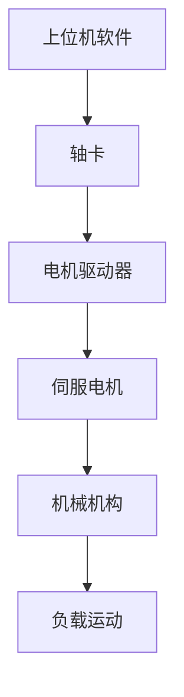
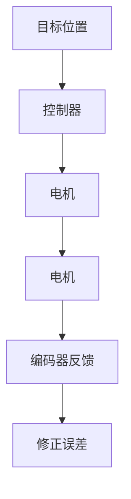
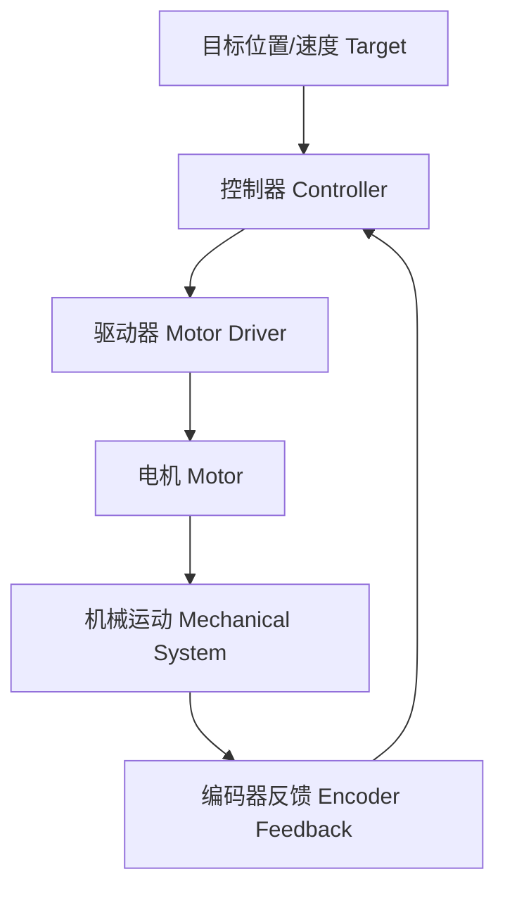
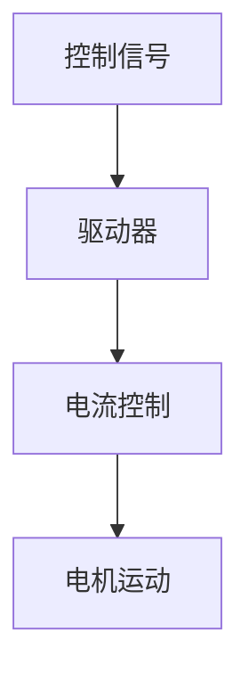
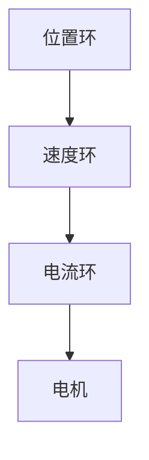

# 从电机到轴卡：工业设备高精度运动控制系统的核心原理


在普通人的认知中，电机通电->电机旋转->设备运动，似乎只需要一个电机就能完成机械运动。但在工业化设备中，例如：半导体检测设备、手机组装设备、MTF光学检测设备、精密点胶设备、贴片机、激光加工设备等。设备要求的不是“运动”，而是移动到指定位置误差小于几个微米、速度稳定、加减速平滑、多轴协同、高重复定位精度、实时响应外部触发等等。例如：

> 一个视觉检测设备，需要相机移动到指定位置拍照，如果运动误差超过5μm，视觉算法得到的结果可能完全失效。

这时候，仅靠电机无法满足需求。工业设备需要一套完整的运动控制系统(Motion Control System)，其中核心的组成就是：

- 电机(Motor)
- 驱动器(Servo Drive)
- 轴卡(Motion Control Card)
- 编码器(Encoder)
- 机械结构(Mechanism)
- 控制软件(Motion Control Software)

<!--more-->

整体关系如下：



## 工业设备为什么不用普通电机？

普通交流电机(电源——交流电机——旋转)结构简单、成本低、速度稳定。应用场景很多，例如电风扇、电泵、传送带等。它的问题是++无法精确控制位置++。要求移动10mm，普通电机只能转一下、转两圈、转很多圈，但是它不知道自己转了多少圈，也不知道当前位置在哪里。

工业设备需要的是：移动10.000mm，实际10.001mm，误差1μm。所以需要可控、可反馈、可修正。这就是**伺服系统**。


## 伺服电机：工业运动的核心

什么是伺服(Servo)？Servo来源Serve(服务、跟随)，意思是++电机能够按照控制指令精确跟随目标运动++。一个伺服系统：



形成闭环：



## 编码器：电机为什么知道自己在哪里？

伺服电机相比普通电机，多了一个关键组件——编码器(Encoder)，其作用是是检测电机角度、转速、方向。

例如：电机旋转一圈，编码器反馈10000个脉冲，那么每个脉冲代表 $\frac{360\degree}{10000} = 0.036\degree$。经过丝杆转换(假设丝杆导程5mm/圈)，那么 $\frac{5mm}{10000} = 0.5μm$。这就是高精度运动的基础。


## 电机驱动器：为什么电机不能直接接电脑？

很多软件工程师容易产生疑问：不能直接给电机发送一个位置吗？

实际上，电脑不能直接控制电机。因为电机需要大电流、电压控制、电流控制、转矩控制，所以需要伺服驱动器(Servo Drive)。


伺服驱动器工作流程如下：



驱动器内部通常包含：电流环(控制电机产生多少力)、速度环(控制转速是否正确)以及位置环(控制是否到达目标位置)，形成三级控制：



## 什么是轴卡？


轴卡：一种专门用于运动控制的硬件控制器，通过高速总线连接计算机，并向伺服驱动器输出运动控制指令，实现多轴高精度运动。

常见厂商：

- [固高科技](https://www.googoltech.com.cn/)
- [雷赛智能](https://www.leisai.com/)
- [研华科技](https://www.advantech.com.cn/zh-cn)
- [ADLINK](https://www.adlinktech.com/en/index)

## 为什么需要轴卡？

软件工程师可能会想：我的程序发送运动指令不行吗？

例如：

```c#
MoveAxis(100);
```

非常简单啊！但是实际运动，伺服电机可能需要每秒几十万脉冲(Pulse, 一个短暂变化的数字电信号)，实时周期0.1ms，普通Windows系统线程调度可能要1ms~几十ms，运控控制要求必须稳定。所以**由轴卡承担实时控制**。

## 轴卡的工作原理

**硬件组成**：运动控制卡通常由芯片、驱动电路、I/O接口、时序控制器、程序存储器、交互接口等组成。其中，芯片是运动控制卡最重要的组成部分，它集成了运动控制的核心算法和数据处理功能，并且控制着整个系统的运行和维护。

**接收主机指令**：运动控制卡通过接口（如PCI、PCIe、USB等）与主机（通常是计算机）连接，并接收主机发送的控制命令。这些命令可能包括运动类型（如直线、圆弧等）、目标位置、速度、加速度等参数。

**解析控制命令**：运动控制卡接收到命令后，会解析命令内容，将其转换为内部可以理解的指令。

**生成运动轨迹**：根据接收到的命令，运动控制卡通过内部运动规划算法生成运动轨迹，并将运动参数设置给相应的轴。这一过程涉及到复杂的数学计算和算法优化，以确保运动的精确性和平滑性。

**驱动器控制**：运动控制卡将生成的运动轨迹和参数通过接口传输给驱动器。驱动器接收到信号后，根据设定的参数和轨迹控制电机或执行器的运动。驱动器可能采用脉冲/方向、脉冲/脉冲等多种输出模式来控制电机的运动。

**位置反馈与闭环控制**：驱动器通过内部的编码器或传感器获取电机或执行器的位置信息，并将反馈信号传回给运动控制卡。运动控制卡通过位置反馈信号与设定的目标位置进行比较，并调整驱动器的输出信号，使电机或执行器运动达到设定的目标位置。这种闭环控制系统可以实时纠正传动过程中的误差，提高运动的精度和稳定性。

**状态监测与报告**：运动控制卡可以监测电机或执行器的状态，如电流、速度等，并将状态信息通过主机接口返回给主机。主机可以利用这些信息对控制系统进行状态监控和故障诊断。

**软件支持**：运动控制卡通常需要配合专业的软件使用，这些软件提供了丰富的编程接口和库函数，方便用户快速开发出满足特定需求的运动控制系统。用户可以使用VC、VB等开发工具调用运动控制卡的函数库，实现各种复杂的运动控制功能。

## 什么是插补？

插补(Interpolation)就是轴卡根据目标轨迹，实时计算多个轴的位置关系，并转换成同步脉冲，使机械按照指定路径运动。这是轴卡的核心能力之一。

先看一个例子。假设设备有X轴和Y轴，现在要求从点A(0,0)移动到点B(100,100)。如果没有插补，可能先移动到点(100,0)，再移动到点B(100,100)，形成一个L形轨迹，很多设备不能接受。而需要直线运动，这就需要插补。

插补的本质就是++把一个复杂运动目标，分解成多个轴的小运动++。常见有直线插补、圆弧插补、螺旋插补等。


## 什么是脉冲当量？

在运动控制领域，脉冲当量(Pulse Equivalent)是一个非常核心的参数。一句话理解：脉冲当量 = 发送一个脉冲，机械实际移动的距离。

## 番外

### 雷赛EtherCAT数字I/O模块状态指示灯说明


|指示灯标识|全程/含义|状态说明
| :--- | :-- | :-- |
|ALM|Alarm 报警|红色：驱动器或控制卡发生严重错误(如过流、过压、编码器故障) 熄灭：正常|
|ELP|Enable Posotive 正向使能|绿色：电机驱动已正向使能(准备好接收正向运动指令)|
|ELN|Enable Negative 负向使能|绿色：电机驱动已负向使能(准备好接收负向运动指令)。注：ELP和ELN常亮绿灯通常表示伺服处于“Servo On”状态|
|EMG|Emergency Stop 急停|绿色：未触发急停(系统正常)。红色：急停按钮被按下或急停回路断开，驱动器进入安全停止状态|
|ORG|Origin 原点|红色：已检测到原点信号(限位/回零开关触发)。熄灭：未检测到原点信号(在回零过程中，此灯亮起表示找到了原点开关)|
|SLP|Servo Lock Positive 正向锁定|绿色：通常配合伺服抱闸或限位锁定状态|
|SLN|Servo Lock Negative 负向锁定|红色：已触发负向限位或软件限位(限位开关动作), 如果此灯亮起，电机将停止并向反方向回退|
|INP|In Position 到位|红色：轴已到达目标位置(定位完成)。熄灭：轴正在运动中，未到达目标位置|
|RDY|Ready 准备好|绿色：控制卡或驱动器已完成初始化，处于就绪状态|
|DSTP|Drive Stop 驱动停止|绿色：驱动器处于停止状态(非急停原因停止)
|SEVON|Servo On 伺服开启|	绿色：伺服电机已上电并使能(电机已励磁，可接收运动指令)|

## 推荐

[CONTEC 运动控制的基础知识](https://www.contec.com/cn/support/basic-knowledge/daq-control/motion-control/)

[SIEMENS 驱动与控制基础](https://www.ad.siemens.com.cn/club/bbs/upload/file/20160610/6360114509051669811078994.pdf)

[固高科技 GTS系列四轴运动控制卡](https://www.googoltech.com.cn/Uploads/file/20240530/20240530113351_58913.pdf)

[雷赛控制技术 EtherCAT 总线卡 用户使用手册](https://www.leisai.com/upload/file/2025/07/31/%E9%9B%B7%E8%B5%9B%E6%8E%A7%E5%88%B6EtherCAT%E6%80%BB%E7%BA%BF%E5%8D%A1%E7%94%A8%E6%88%B7%E4%BD%BF%E7%94%A8%E6%89%8B%E5%86%8C20250728.pdf)





[驱控系统的控制协议及方式](https://blog.csdn.net/qq_40598340/article/details/128503385)

[CiA 402（DS402）伺服驱动器协议详解](https://blog.csdn.net/2501_94586448/article/details/161724605)

[雷赛（Leadshine）EtherCAT 数字 I/O 模块（如 EMC-E5064-8）的状态指示灯（I/O 状态）说明](https://blog.csdn.net/cjh16606260986/article/details/161870263)

## 参考

[一文详解运动控制卡的工作原理是什么？](http://jiepus.com/wz/458.html)


---

> 作者: [AndyFree96](https://andyfree96.github.io/)  
> URL: http://localhost:1313/%E4%BB%8E%E7%94%B5%E6%9C%BA%E5%88%B0%E8%BD%B4%E5%8D%A1-%E5%B7%A5%E4%B8%9A%E8%AE%BE%E5%A4%87%E9%AB%98%E7%B2%BE%E5%BA%A6%E8%BF%90%E5%8A%A8%E6%8E%A7%E5%88%B6%E7%B3%BB%E7%BB%9F%E7%9A%84%E6%A0%B8%E5%BF%83%E5%8E%9F%E7%90%86/  

